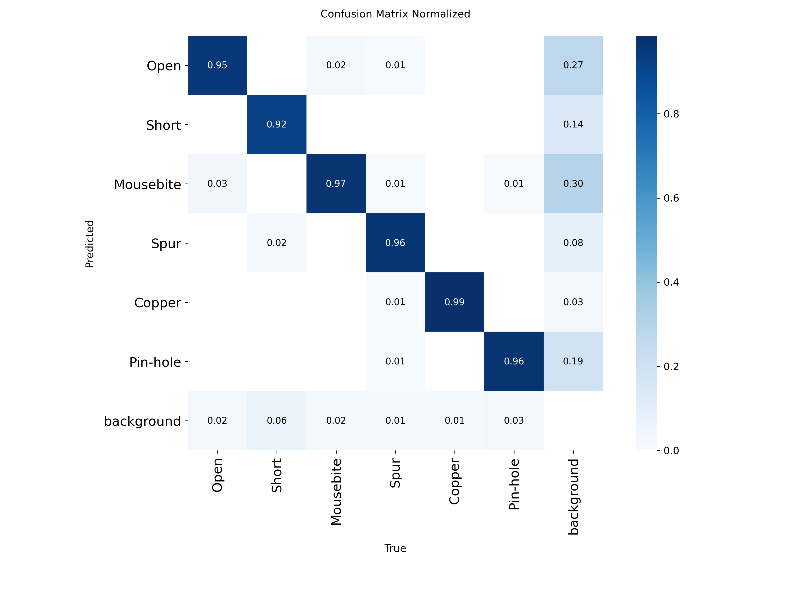

# PCB Defect Auditor

**Try it in your browser:** [https://pcb-defect-auditor.onrender.com/demo](https://pcb-defect-auditor.onrender.com/demo). Upload a JPEG or PNG of a bare PCB and every detected defect is outlined on the image, with a results table. It works on phones.

**Live API:** [https://pcb-defect-auditor.onrender.com/docs](https://pcb-defect-auditor.onrender.com/docs)
*(Speed: on a laptop CPU (Intel i7-1260P) one image takes 47 ms on average end to end: decoding, preprocessing, the model and NMS, not counting network or database time; see [Benchmark](#benchmark). The live site runs on Render's free tier, which has far less CPU, so a request there can take several seconds, especially right after the server wakes from sleep.)*

An automated optical inspection API for printed circuit boards. A YOLOv8 model, exported to ONNX and served through FastAPI, detects and classifies PCB defects and logs every inspection to a Postgres database (Neon) for later analysis.

Built as a self-directed project to go beyond model training into the full lifecycle: data, training, serving, storage, and deployment.

---

## System Architecture

```
PCB Image Upload
      │
      ▼
FastAPI /inspect endpoint
      │
      ▼
OpenCV preprocessing (resize, normalize, transpose)
      │
      ▼
ONNX Runtime inference (YOLOv8, CPU)
      │
      ▼
NMS + confidence filtering → every detection: type, confidence, box
      │
      ├──▶ Response: all detections, boxes scaled back to the original image's pixels
      │
      ▼
Neon Postgres — inspections table (one row: the top defect)
```

- **Inference:** YOLOv8n, fine-tuned on DeepPCB, exported to ONNX (11.7MB) so the API doesn't need a full PyTorch runtime to serve predictions.
- **Backend:** FastAPI with SQLAlchemy ORM. `/inspect` is a plain (not `async`) function on purpose: the ONNX model and the database write both block, so FastAPI runs it in its thread pool and a slow request can't hold up the others.
- **Storage:** Neon (serverless Postgres) — chosen specifically to sidestep local Docker setup issues during development, and it turned out to be a genuinely good fit for a small project like this.

---

## Core Engineering Decisions

**Server-side payload validation.** Trusting a client-provided HTTP header (like `content-type: image/jpeg`) isn't enough — a client can set that header to anything regardless of what the file actually contains. This architecture decodes the raw byte stream directly with `cv2.imdecode` before it ever reaches the ONNX inference engine. A corrupted byte array or a mislabeled non-image payload (like a PDF sent with a fake image content-type) fails that decode step and is rejected with a clean `400`, rather than crashing further downstream.

**GUI-less containerization.** The deployment strips OS-level display dependencies (e.g. `libgl1`) by using `opencv-python-headless` instead of full OpenCV. Smaller image, faster builds, no display-server dependencies a backend service never needed in the first place.

**No silent fallback when the model is missing.** `PCBDefectModel` resolves `models/pcb_defect_v1.onnx` from its own file location (so the app works from any working directory) and refuses to start with a clear `FileNotFoundError` if the file is missing, rather than serving made-up predictions. The model is committed to this repo (11.7MB), so CI and the deployment always run the real model.

**Graceful degradation on database failure.** Inference and persistence are decoupled — if the Neon write fails (observed in practice during a free-tier cold start), the API still returns the real inference result to the caller with a `partial_success` status, instead of losing a successful prediction because of an unrelated storage hiccup.

---

## Defect classes

The model detects six PCB fabrication defects, trained on the DeepPCB dataset:

1. **Open** — broken copper trace, causing an open circuit
2. **Short** — unintended bridge between adjacent conductive paths
3. **Mousebite** — small cutouts or jagged edges along a trace
4. **Spur** — unwanted copper protrusion off a trace
5. **Copper** — residual, unetched copper flakes
6. **Pin-hole** — voids in a conductive pad or trace

## Known limitations

- **Out-of-distribution inputs can produce confident false positives.** The model was trained strictly on the DeepPCB distribution and has no "not a PCB" class — feeding it an unrelated image doesn't reliably get rejected. Tested directly: an unrelated non-PCB image returned `"Spur"` at 0.44 confidence rather than a clear rejection.
- **No background/negative class.** There's no dedicated category for "this isn't a defect" — every confident detection gets forced into one of the six known classes.
- **Content-type validation works correctly for non-image files.** A `.pdf` sent to `/inspect` was correctly rejected with a `400`, confirmed directly against the live deployment.
- **Slow on the free tier, especially after a sleep.** Render's free tier puts the service to sleep when it isn't used, and the first request has to wake it up. Even when it is awake, its small CPU means a request can take several seconds, much more than the 47 ms per image measured on a laptop (see [Benchmark](#benchmark)).
- **One image at a time.** `/inspect` takes a single image per request; there is no batch upload.
- **Only the top defect is saved.** The response lists every detection, but the database stores one row per inspection: the most confident defect. The other detections are not kept.
- **No authentication or rate limiting.** Anyone with the URL can upload images and read the logged inspections, and nothing limits how many requests a client sends.
- **Trained on one dataset.** The model has only seen DeepPCB, whose defects were added artificially to images of real boards (see [A note on the dataset](#a-note-on-the-dataset)). Real factory images, with other cameras, lighting, resolutions and board types, may look quite different, and the scores above may not hold for them.

---

## Evaluation

Trained YOLOv8n for 99 epochs on DeepPCB (early-stopped from a 100-epoch budget, patience=20, best weights from epoch 79). Full training run: `notebooks/train_pcb_model.ipynb`.

**Overall (test split, 150 images, 984 instances; the same split chose the best epoch, see [A note on the dataset](#a-note-on-the-dataset)):**

| Metric | Value |
|---|---|
| Precision | 0.974 |
| Recall | 0.952 |
| mAP50 | 0.979 |
| mAP50-95 | 0.791 |

**Per class:**

| Class | mAP50 | mAP50-95 |
|---|---|---|
| Open | 0.988 | 0.731 |
| Short | 0.948 | 0.703 |
| Mousebite | 0.976 | 0.769 |
| Spur | 0.976 | 0.751 |
| Copper | 0.995 | 0.911 |
| Pin-hole | 0.989 | 0.879 |

Full numbers and raw per-epoch log: `docs/training_results/metrics.md` and `results.csv`.

### Confusion matrix



The diagonal is strong across every class (0.92–0.99) — the model isn't confusing defect types with each other. The real weak spot is the background column: Mousebite (0.30) and Open (0.27) are the two classes most often triggered by substrate edges or normal board texture that isn't actually a defect. That's a background-vs-defect problem, not a defect-vs-defect problem.

---

## Benchmark

CPU speed of the ONNX model, one image at a time, over 50 DeepPCB test images. Full method and numbers: [docs/benchmark.md](docs/benchmark.md).

| Measurement | Mean | Throughput |
|---|---|---|
| End to end (decode, preprocess, model, NMS) | 47.2 ms | 21.2 images/s |
| Model only | 36.6 ms | 27.3 images/s |

These were measured on a laptop CPU (12th Gen Intel i7-1260P) and don't include network or database time. The live site's free-tier CPU is much slower.

---

## Project structure

```
pcb-defect-auditor/
├── .github/workflows/       # CI pipeline definitions
├── app/
│   ├── main.py               # FastAPI app: every endpoint lives here
│   ├── static/demo.html      # The /demo page (one file, inline CSS and JavaScript)
│   ├── db/                   # SQLAlchemy models, database connection
│   ├── ml/                   # ONNX inference session, preprocessing, NMS, upload checks
│   ├── api/, core/           # Empty placeholders, not used yet
│   └── __init__.py           # App version, reported by /health
├── docs/                     # Evaluation and benchmark write-ups, training results
├── models/
│   └── pcb_defect_v1.onnx    # Exported YOLOv8 weights (committed — see note below)
├── notebooks/                # Full training notebook
├── samples/                  # Demo images, local only (README.md explains)
├── scripts/
│   ├── convert_labels.py     # Converts DeepPCB labels to YOLO format
│   ├── evaluate.py           # Precision/recall/mAP of the ONNX model on DeepPCB splits
│   ├── benchmark.py          # CPU inference speed of the ONNX model
│   └── pick_samples.py       # Copies one validation image per class into samples/
├── sql/
│   ├── schema.sql
│   └── analytics.sql         # Hand-written analysis queries (not run by the app)
├── tests/
├── Dockerfile
├── requirements.txt
└── README.md
```

**Note on `models/`:** weight files are normally gitignored, but `pcb_defect_v1.onnx` is committed here as an explicit exception (`!models/pcb_defect_v1.onnx` in `.gitignore`), since Render builds directly from this GitHub repo and needs the file present at build time. At 11.7MB, this is a reasonable tradeoff at this project's scale.

---

## A note on the dataset

Trained and evaluated on the DeepPCB dataset (https://github.com/tangsanli5201/DeepPCB), associated with the paper 'On-line PCB Defect Detector On A New PCB Defect Dataset', using the Kaggle repackaging 'pcb-defect-detection-dataset' by liuxiaolong1. The DeepPCB repository states that the dataset may only be used for research purposes; this project is a non-commercial portfolio demonstration. The current version of this repository contains no dataset images.

How it got there (all of it is in `notebooks/train_pcb_model.ipynb`):

1. **PKU-Market-PCB through Roboflow, dropped.** The first run (50 epochs) used a Roboflow export of PKU-Market-PCB whose `data.yaml` had placeholder class names (Roboflow's own boilerplate text) instead of defect names. Per-class mAP50 came out between about 0.07 and 0.2. After the names were corrected, a second run was started but stopped before it finished, so no final results were saved for it. This dataset was then dropped.
2. **DeepPCB from the Kaggle repackaging, used for the model here.** Its labels are corner coordinates with class numbers 1–6, not YOLO format, so the first DeepPCB training attempts found no usable labels. `scripts/convert_labels.py` (the same code as the notebook cell) converts them to YOLO format. Training then worked, and the results in [Evaluation](#evaluation) are from that run.

What that means for the numbers:

- **This is the Kaggle copy, not the official split.** It splits the boards 1,200 / 150 / 150 (train / valid / test). The official DeepPCB release splits 1,000 / 500.
- **The test split also chose the best epoch.** Training used the 150-image test split as its validation set, so the test scores are a little optimistic. The 150-image `valid` split was not used during training; its scores are in `docs/evaluation.md`.
- **The defects are artificial.** The DeepPCB authors added the defects to images of real boards; they are not defects from a production line.
- **Not comparable with the DeepPCB paper.** The mAP here counts a detection as correct at IoU 0.5; the DeepPCB paper uses 0.33. The scores can't be compared with theirs.

The broader lesson from the first attempt: a model can train "successfully" (loss going down, no errors) against completely wrong labels, and only checking labelled images against the ground truth by eye shows it.

---

## CI/CD & deployment

- **Testing:** on every push to `main`, GitHub Actions runs the `pytest` suite on Ubuntu, then test-builds the Docker image. The tests use temporary SQLite databases, never a live one. Some use a fake model to control the output; others run the real committed ONNX model. The demo page's JavaScript is tested with Node.js, which GitHub's runners include. Branches are not tested in CI until they are merged.
- **Deployment:** Render pulls this repository directly and builds the Docker image from the committed `Dockerfile`, then runs Uvicorn. This has been verified against a live, successful deploy — see the live link above.

---

## Running it locally

```bash
git clone https://github.com/AarushiSharma1515/pcb-defect-auditor.git
cd pcb-defect-auditor

python -m venv .venv
.venv\Scripts\activate        # Windows
# source .venv/bin/activate   # Linux/macOS

pip install -r requirements.txt
```

Choose a database. To use Postgres (e.g. Neon), create a `.env` file in the root:
```env
DATABASE_URL=postgresql://<user>:<password>@<neon-host>/<dbname>?sslmode=require
```
Or, to try it without any database server, use a local SQLite file instead. It keeps test uploads out of your real database:
```bash
export DATABASE_URL=sqlite:///./local.db          # Linux/macOS
$env:DATABASE_URL = "sqlite:///./local.db"        # Windows PowerShell
```
(A `DATABASE_URL` already set in your environment wins over `.env`. The model path is resolved from the code, `models/pcb_defect_v1.onnx`, so no setting is needed for it.)

Run it:
```bash
uvicorn app.main:app --reload
```
Then open `http://127.0.0.1:8000/demo` for the demo page, or `http://127.0.0.1:8000/docs` for the interactive API.

Optional: to get clickable sample boards on the demo page, put the Kaggle repackaging's validation split at `data/DeepPCB/valid/` (with its `images/` and `labels/` folders) and run `python scripts/pick_samples.py`. It copies one validation image per defect class into `samples/`. Those copies are ignored by git and Docker and stay on your machine (see `samples/README.md`).

Run the tests:
```bash
pytest -q
```
They use a temporary SQLite database, never the one in `.env`. The demo page's JavaScript tests need Node.js and are skipped without it.

---

## API

Interactive documentation for every endpoint: `/docs`.

**`POST /inspect`** — run an inspection
- Form fields: `board_id` (string, at most 100 characters) and `file` (the image).
- The image must be a JPEG or PNG (checked from the file's content, not its name or content type), at most 10 MB and 25 megapixels.
- Response (a real result for one DeepPCB validation image, shortened to two detections):
```json
{
  "status": "success",
  "board_id": "PANEL-004",
  "requires_human_review": false,
  "telemetry": {
    "defect_type": "Copper",
    "confidence": 0.9376,
    "processing_ms": 85
  },
  "detections": [
    {"defect_type": "Copper", "confidence": 0.9376, "box": [213, 125, 255, 166]},
    {"defect_type": "Short", "confidence": 0.8707, "box": [136, 484, 192, 520]}
  ],
  "image_width": 640,
  "image_height": 640
}
```
- `detections` lists every defect found, best first. Each `box` is `[x1, y1, x2, y2]` in the **original** image's pixels, not the model's 640×640 input.
- `telemetry` is the top defect. That is the one row saved to the database. With no detections it is `"no_defect_detected"` with confidence 0.
- `requires_human_review` is `true` when the top confidence is below 0.5.
- If the result couldn't be saved, `status` is `"partial_success"` and a `message` says so. The result itself is still valid.
- Errors: `400` (empty file, not a JPEG/PNG, or a corrupted image), `413` (over 10 MB or 25 megapixels), `422` (a missing field, or `board_id` over 100 characters). Each has a plain-English `detail`.
- `board_id` `"demo"` is reserved for the demo page. For those, the file name is not stored (`image_path` is saved as `"demo-upload"`), and they are left out of `/analytics/summary`.

**`GET /health`** — always `200`. Says whether the model is loaded and the database answers a `SELECT 1` within 6 seconds.
```json
{"model_loaded": true, "model_file": "pcb_defect_v1.onnx", "mode": "onnx", "database": "ok", "version": "1.1.0"}
```
`database` is `"ok"` or `"unreachable"`.

**`GET /demo`** — the browser demo page (see the top of this README).

**`GET /inspections?limit=50&offset=0`** — logged inspections, newest first. `limit` is 1–200 (default 50); use `offset` for the next page.

**`GET /analytics/summary`** — totals over all logged inspections except demo uploads.
```json
{"total_inspections": 24, "average_confidence": 0.9112, "defect_breakdown": {"Copper": 14, "Pin-hole": 9, "Spur": 1}, "demo_inspections_excluded": 3}
```

**`GET /samples`** — names of the demo images in `samples/`, e.g. `["1_open_01_PCB__1257.jpg"]`. An empty list if there are none. The repository and the deployed site ship none (see `samples/README.md`).

**`GET /samples/{name}`** — one of those images. Only names that `/samples` lists are served (`404` otherwise, `400` for anything that looks like a path).

**`GET /`** — a simple "is it running" check.
```json
{"status": "PCB Defect Auditor is running"}
```

`/inspections` and `/analytics/summary` answer `503` with a JSON `detail` while the database is unreachable. `/inspect` still works then, and returns `partial_success`.

---

## Tech stack

Python · FastAPI · SQLAlchemy · PostgreSQL (Neon) · YOLOv8 · ONNX Runtime · OpenCV · pytest · Docker · GitHub Actions